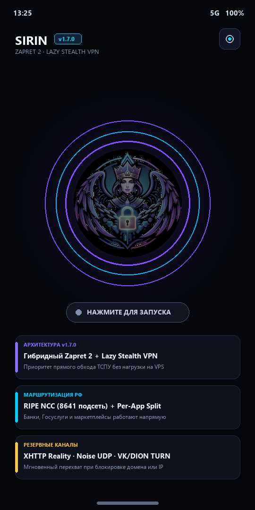
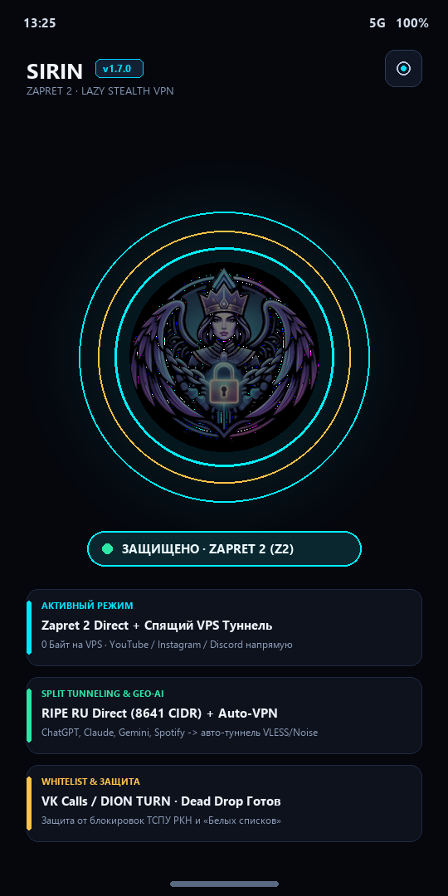
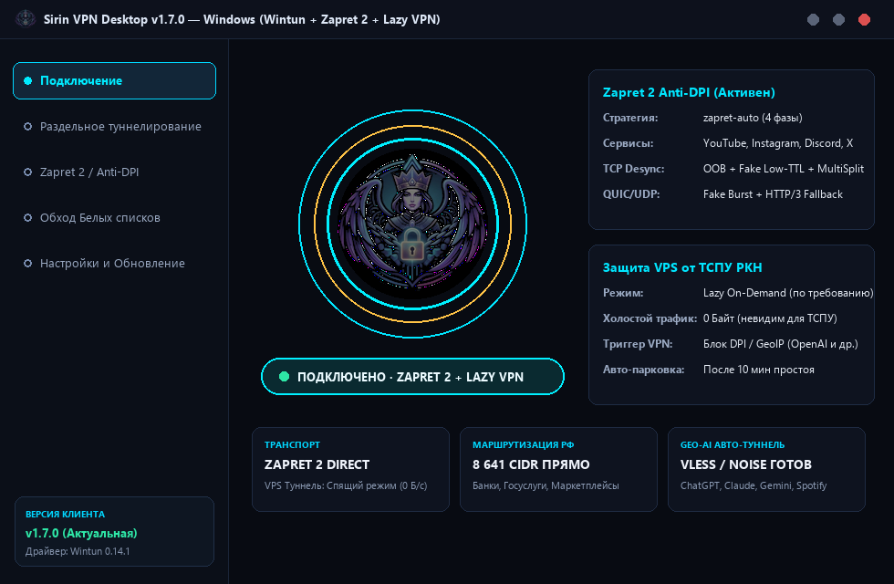
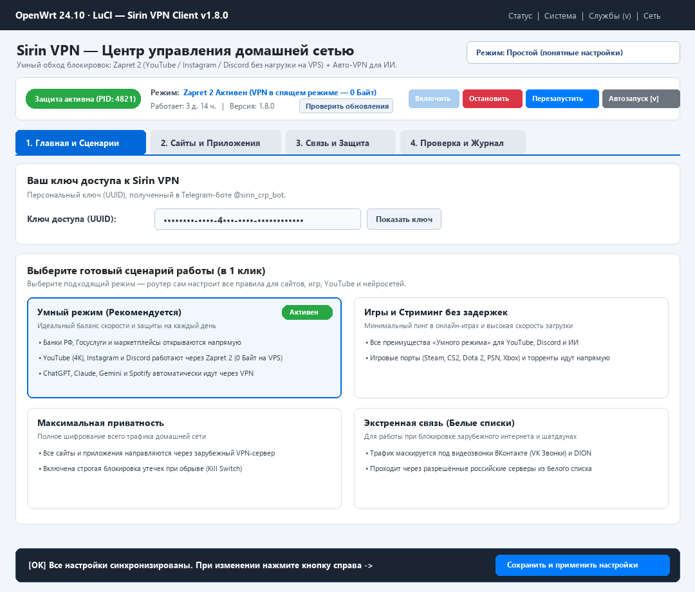

<div align="center">
  
  <h1>Сирин (Sirin) VPN</h1>
  <p><strong>Гибридный комплекс обхода блокировок ТСПУ РКН: нативный Zapret 2 + Спящий (Lazy On-Demand) Stealth VPN для всей экосистемы устройств</strong></p>

  <p>
    <a href="LICENSE"></a>
    <a href="https://github.com/goodbrat-lab/sirin-vpn/releases/tag/v1.7.0"></a>
    <a href="https://github.com/goodbrat-lab/sirin-vpn/releases/tag/router-v1.8.0"></a>
    <a href="https://github.com/goodbrat-lab/sirin-vpn/releases/tag/desktop-v1.7.0"></a>
    <a href="https://github.com/goodbrat-lab/sirin-vpn/discussions"></a>
    <a href="https://goodbrat-lab.github.io/sirin-vpn/"></a>
  </p>
</div>

---

## ⚡ Что это и как работает архитектура v1.7.0

**Сирин (Sirin) VPN** — независимый клиент-серверный комплекс обхода цензуры нового поколения, объединяющий **прямую пакетную десинхронизацию ТСПУ (технологии Zapret 2)** и **спящий по требованию (Lazy On-Demand) криптотуннель до зарубежного VPS**.

### Ключевые технологии комплекса:
1. **Нативный движок Zapret 2 (Первичный контур — 0 Байт на VPS):**
   - Для **YouTube (4K/8K)**, **Instagram / Meta**, **Discord (голос и чат)**, **X / Twitter** и большинства сайтов клиент сначала применяет прямое соединение с многоступенчатой десинхронизацией DPI (`tlsrec_sni_split`, `TCP Urgent MSG_OOB`, `Fake ClientHello с малым TTL и битым TCP checksum`, `3-way MultiSplit`, `UDP Fake Burst`).
   - Пока работает прямой обход Zapret 2, VPN-туннель к вашему зарубежному VPS находится в **спящем режиме (0 Байт трафика)** — ТСПУ РКН не видит постоянных шифрованных сессий к вашему серверу и не блокирует IP-адрес VPS.
2. **Бесшовный перехват в Lazy On-Demand VPN (Вторичный контур):**
   - Если ТСПУ провайдера заблокировал ресурс по IP-подсети (и все 4 фазы Zapret 2 не получили ответа) **или** вы открываете сервис с гео-блокировкой со стороны самого зарубежного сайта (**ChatGPT / OpenAI, Claude, Gemini, Grok, Spotify, Autodesk** и др.), клиент автоматически за миллисекунды пробуждает шифрованный VPN-туннель (`VLESS Reality XTLS-Vision`, `XHTTP/2 Reality` или `UDP Noise NK`) и прозрачно перенаправляет этот поток через зарубежный VPS.
   - После 10 минут отсутствия трафика туннель автоматически паркуется обратно в спящий режим.
3. **Раздельное туннелирование (RuDirect 8641 CIDR + Порты):**
   - Встроенная агрегированная база подсетей РФ от RIPE NCC (`8641 CIDR`) и правила по портам (`Gaming Bypass`) обеспечивают прямой доступ к российским банкам, Госуслугам, маркетплейсам и онлайн-играм с минимальным пингом.
4. **Аварийный обход «Белых списков» (VK Calls / DION WebRTC TURN) и Dead Drop:**
   - При тотальной блокировке зарубежных IP на мобильных сетях трафик маскируется под видеозвонки ВКонтакте (`VK Calls`) и корпоративной платформы `DION` через отечественные серверы WebRTC TURN из белого списка Минцифры.
   - При блокировке управляющего домена клиент автоматически загружает свежую конфигурацию через резервные хранилища **Dead Drop** (Яндекс Диск / S3).

---

## 📱 Выберите платформу

| Платформа | Версия | Где скачать | Руководство по установке | Статус |
|:---|:---:|:---|:---|:---:|
| **Android** | `1.7.0` | [📦 Скачать APK](https://github.com/goodbrat-lab/sirin-vpn/releases/download/v1.7.0/sirin-v1.7.0.apk) | [📖 Инструкция для Android](docs/README.md#11-android) | ✅ Стабильный |
| **Windows Desktop** | `1.7.0` | [📦 Скачать Setup.exe](https://github.com/goodbrat-lab/sirin-vpn/releases/download/desktop-v1.7.0/Sirin-VPN-1.7.0-Setup.exe) | [📖 Инструкция для Windows](docs/README.md#12-windows-desktop) | ✅ Стабильный |
| **Router (OpenWrt)** | `1.8.0` | [📦 Релиз архивы и пакеты (.ipk / .apk для 5 архитектур)](https://github.com/goodbrat-lab/sirin-vpn/releases/tag/router-v1.8.0) | [📖 Руководство OpenWrt & LuCI](docs/ROUTER.md) | ✅ Стабильный |
| **iOS / iPadOS** | — | *В разработке (архитектура NetworkExtension)* | [🔬 Исследование (Spike iOS)](docs/SPIKE_IOS.md) | ⏳ Скоро (Q1 2027) |
| **macOS / Linux** | — | *Запланировано на базе Wails & core/engine* | [🗺️ Roadmap](docs/ROADMAP.md) | ⏳ Скоро |

---

## 🚀 Быстрый старт

### 🤖 Android
1. Загрузите и установите [sirin-v1.7.0.apk](https://github.com/goodbrat-lab/sirin-vpn/releases/download/v1.7.0/sirin-v1.7.0.apk).
2. Запустите приложение и вставьте персональный ключ (UUID из Telegram-бота `@sirin_crp_bot` или откройте deep-link ссылку).
3. Нажмите центральную кнопку Сирин — активируется режим **Zapret 2 + Lazy VPN (`Z2`)**.

### 💻 Windows Desktop
1. Скачайте инсталлятор [Sirin-VPN-1.7.0-Setup.exe](https://github.com/goodbrat-lab/sirin-vpn/releases/download/desktop-v1.7.0/Sirin-VPN-1.7.0-Setup.exe) и завершите установку.
2. В окне клиента укажите ваш ключ и нажмите **«Подключить»** (доступно встроенное автообновление прямо из настроек приложения).

### 🌐 Router (OpenWrt 21.x – 24.x `opkg` и 25.x `apk`)
Выполните одну команду в терминале SSH роутера (автоматически определит архитектуру `mips`, `mipsle`, `armv7`, `arm64`, `x86_64`, установит демон и веб-интерфейс LuCI):
```bash
wget -O - https://raw.githubusercontent.com/goodbrat-lab/sirin-vpn/master/apps/router/install.sh | sh
```
После установки откройте веб-интерфейс роутера: **Службы → Sirin VPN**, введите ключ и сохраните параметры. Обновлять клиент в дальнейшем можно одной кнопкой **«Проверить обновления»** прямо в LuCI.

---

## 📸 Скриншоты интерфейса (v1.7.0)

<div align="center">
  <h3>Мобильное приложение (Android — Cyber-Neon UI)</h3>
  
  &nbsp;&nbsp;&nbsp;&nbsp;
  
</div>

<br/>

<div align="center">
  <h3>Клиент для Windows Desktop (Wintun + Zapret 2 + Lazy VPN)</h3>
  
</div>

<br/>

<div align="center">
  <h3>Веб-интерфейс роутера (LuCI OpenWrt)</h3>
  
</div>

---

## 📚 Документация

Полная техническая документация и руководства пользователей структурированы в каталоге [**`docs/`**](docs/README.md) и на [**GitHub Pages**](https://goodbrat-lab.github.io/sirin-vpn/):

- **Установка и настройка:**
  - [Полное руководство по Router OpenWrt и LuCI UI](docs/ROUTER.md)
  - [Сборка и установка пакетов `.ipk` и `.apk` для OpenWrt](docs/OPENWRT_PACKAGES.md)
  - [Чеклист верификации установки на роутер](docs/ROUTER_INSTALL_VERIFICATION.md)
- **Управление и Telegram-бот:**
  - [Справочник команд и функций Telegram-бота](docs/BOT_COMMANDS.md)
  - [Карта интерактивных диалогов бота (UX Map)](docs/BOT_UX_MAP.md)
- **Диагностика и архитектура:**
  - [Известные проблемы и решения (Known Issues)](docs/KNOWN_ISSUES.md)
  - [План развития проекта (Roadmap)](docs/ROADMAP.md)
  - [Архитектура защиты «Невидимая вуаль»](docs/ROADMAP_INVISIBLE_VEIL.md)

---

## 🗺️ Roadmap проекта

Актуальные задачи и статус разработки отслеживаются в [docs/ROADMAP.md](docs/ROADMAP.md) и [docs/ROADMAP_INVISIBLE_VEIL.md](docs/ROADMAP_INVISIBLE_VEIL.md):

| Статус | Задача | Платформа / Компонент |
|:---:|---|---|
| 🟢 **Готово** | Нативный движок **Zapret 2** (4 стратегии десинхронизации DPI) + **Lazy On-Demand VPS VPN** (0 Байт в покое) | Android, Windows, Router (`v1.7.0`) |
| 🟢 **Готово** | Автоматический обход GeoIP-блокировок ИИ (ChatGPT, Claude, Gemini, Spotify, CAD) через принудительный VPN | Core Engine / Router (`v1.7.0`) |
| 🟢 **Готово** | Аварийный обход «Белых списков» через отечественные WebRTC TURN релеи (**VK Звонки / DION**) + **Dead Drop** (Яндекс Диск / S3) | Core Engine / All Clients (`v1.6.0`) |
| 🟢 **Готово** | Встроенное автообновление в один клик (In-App Updater) для OpenWrt LuCI и Windows Desktop | Router & Windows (`v1.6.0`) |
| 🟢 **Готово** | Раздельное туннелирование по подсетям РФ (8641 CIDR RIPE NCC) и портам (`Gaming Bypass`), автономные пакеты `.ipk` / `.apk` | Router & Windows (`v1.4.0–v1.5.0`) |
| 🟡 **В работе** | Интеграция автоматического биллинга (Telegram Stars / СБП) в Telegram-боте | Server / Bot |
| 🔵 **В планах** | Клиент для iOS / iPadOS на базе NetworkExtension + Go Mobile | iOS Client |
| 🔵 **В планах** | Сборка Desktop-клиента под macOS и Linux | Desktop Client |

---

## ⚖️ Лицензия

Проект распространяется под открытой лицензией [MIT](LICENSE). Разработан на основе наработок Meridian VPN (JinComputers). Подробная информация об авторских правах приведена в [NOTICE](NOTICE).
