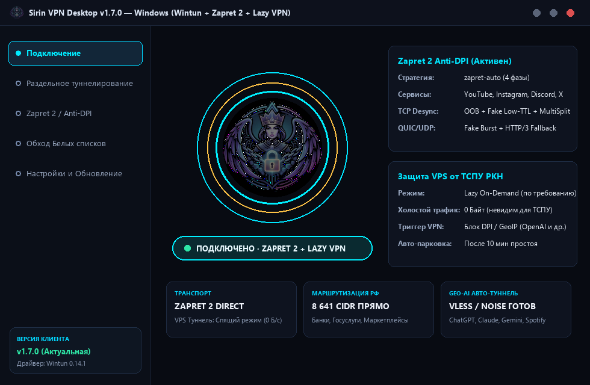

# Sirin VPN — Windows Desktop Client (v1.7.0)

Десктопный клиент **Sirin VPN** для Windows 10 / 11 на базе **Wails v3**, драйвера **Wintun** и единого крипто-ядра `core/engine`.

<div align="center">
  
</div>

---

## ⚡ Ключевые возможности (v1.7.0)

1. **Гибридный движок Zapret 2 + Спящий по требованию VPS VPN (`Lazy On-Demand`):**
   - Прямой обход замедления и блокировок ТСПУ РКН для **YouTube, Instagram, Discord, X/Twitter** через встроенный пользовательский стек `tunZapretInterceptor` (адаптивное разбиение TLS Record `SNI`, инъекция `TCP Urgent MSG_OOB`, `3-way MultiSplit`, `UDP Fake Burst`).
   - **Защита VPS от блокировки (0 Байт в покое):** пока трафик проходит через прямой контур Zapret 2 или идёт на российские сайты, VPN-туннель к вашему зарубежному VPS находится в спящем режиме.
   - **Бесшовное пробуждение для Geo-AI и заблокированных IP:** при обращении к **ChatGPT / OpenAI, Claude, Gemini, Grok, Spotify, Autodesk** или при отказе прямого пробоя клиент за миллисекунды поднимает зашифрованный туннель (`VLESS Reality`, `XHTTP/2` или `UDP Noise NK`).
2. **Высокоскоростное раздельное туннелирование (RuDirect 8641 CIDR):**
   - Мгновенная загрузка 8641 агрегированной подсети РФ (RIPE NCC) в таблицу маршрутизации Windows через нативный Win32 API (`CreateIpForwardEntry2`).
   - Поддержка режимов `Bypass` (исключить из VPN) и `Only` (только выбранные домены/IP через VPN).
3. **Аварийный обход «Белых списков» (VK Calls / DION WebRTC TURN) и Dead Drop:**
   - Автоматический переход на туннелирование через отечественные серверы WebRTC TURN ВКонтакте и DION при блокировке зарубежного трафика.
   - Резервное получение конфигурации через Яндекс Диск и S3 (`Dead Drop`).
4. **Встроенное автообновление (In-App Updater):**
   - Проверка новых версий на GitHub Releases, скачивание с проверкой PE-заголовка (`MZ`) и бесшовная установка в один клик прямо из настроек приложения.

---

## 🚀 Установка и сборка

### Установка готового релиза
Скачайте инсталлятор **[Sirin-VPN-1.7.0-Setup.exe](https://github.com/goodbrat-lab/sirin-vpn/releases/download/desktop-v1.7.0/Sirin-VPN-1.7.0-Setup.exe)** со страницы релизов. Драйвер `wintun.dll` уже включён в комплект поставки.

### Сборка из исходного кода
```powershell
cd apps/desktop
go test ./...
go build -ldflags="-s -w -H windowsgui" -o bin/sirin.exe .
```
Для сборки установщика `Sirin-VPN-1.7.0-Setup.exe` откройте `build/windows/installer.iss` в **Inno Setup 6** или выполните `ISCC.exe build\windows\installer.iss`.
