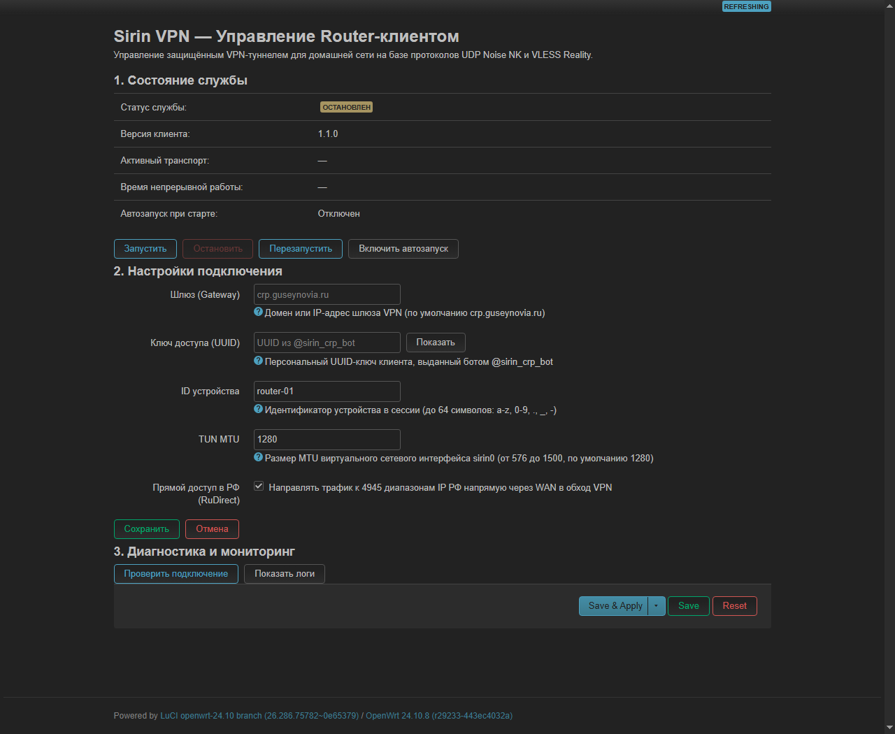
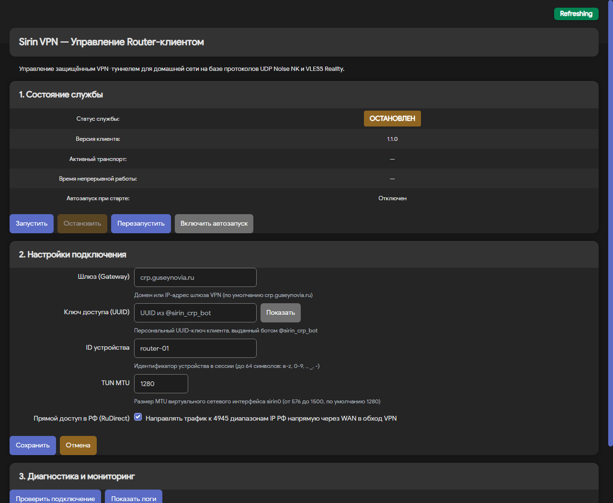
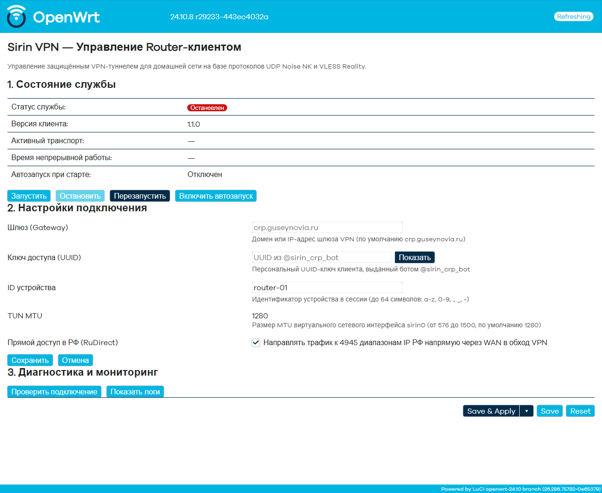

# Руководство по использованию Sirin Router (OpenWrt)

Клиент **Sirin VPN** для роутеров под управлением OpenWrt обеспечивает прозрачное туннелирование трафика всех устройств домашней сети через защищённый протокол (UDP Noise NK с автоматическим переключением на VLESS Reality при блокировках).

---

## 1. Системные требования

- **Операционная система:** OpenWrt 24.x (пакетный менеджер `opkg`) или OpenWrt 25.x (пакетный менеджер `apk`).
- **Свободная память:** не менее 10–15 МБ во Flash-памяти роутера (размер бинарного файла ~9–10 МБ).
- **Ядро:** поддержка TUN-устройств (`kmod-tun`).
- **Файрвол:** `nftables` (стандарт в OpenWrt 22+) либо классический `iptables`.
- **Сертификаты TLS:** установленные корневые сертификаты для загрузки по HTTPS.

---

## 2. Подключение по SSH

Подключитесь к командной строке вашего роутера с локального компьютера:

```bash
ssh root@192.168.1.1
```
*(Если IP-адрес роутера был изменён, укажите ваш актуальный адрес шлюза).*

---

## 3. Установка

### 3.1. Подготовка сертификатов (для чистых систем)

Если на роутере ещё не установлены пакеты поддержки SSL/TLS для `wget`, выполните предварительную команду:

```bash
# Для OpenWrt 24.x (opkg):
opkg update && opkg install ca-bundle wget-ssl

# Для OpenWrt 25.x (apk):
apk update && apk add ca-certificates wget-ssl
```

### 3.2. Автоматическая установка в одну команду

Выполните команду автоустановщика:

```bash
wget -O - https://raw.githubusercontent.com/goodbrat-lab/sirin-vpn/master/apps/router/install.sh | sh
```

Скрипт автоматически:
1. Определит архитектуру процессора роутера (`mips`, `mipsle`, `armv7`, `arm64` или `x86_64`).
2. Загрузит соответствующий релизный архив с GitHub.
3. Разместит бинарник `/usr/bin/sirin-client` и init-скрипт `/etc/init.d/sirin`.
4. Создаст шаблон конфигурации `/etc/sirin/client.toml` (если файл ещё не существует).
5. Установит веб-интерфейс LuCI (если LuCI обнаружен в системе).
6. Настроит OpenWrt Firewall (добавит `sirin0` в зону `wan`, включит `masq=1` и `mtu_fix=1`).
7. Установит необходимые зависимости (`kmod-tun`, `nftables`, `ip-full`).
8. Включит службу в автозагрузку системы.

#### Флаги установщика `install.sh`:
- `--with-ui` — принудительно установить веб-интерфейс LuCI (по умолчанию: авто).
- `--no-ui` — пропустить установку веб-интерфейса LuCI.
- `--configure-firewall` / `--no-configure-firewall` — включить или отключить автодобавление `sirin0` в зону `wan` фаервола (по умолчанию: включено при наличии UI, выключено в headless-режиме).
- `--strict-tunnel` — включить защиту от DNS-спуфинга провайдера и утечек через IPv6 (настройка `dnsmasq` и `odhcpd`, см. раздел [DNS и IPv6](#dns-и-ipv6)).

Пример установки с жесткой изоляцией DNS и IPv6:
```bash
wget -O - https://raw.githubusercontent.com/goodbrat-lab/sirin-vpn/master/apps/router/install.sh | sh -s -- --strict-tunnel
```

### 3.3. Ручная установка (без прямого выхода в интернет)

Если роутер временно не имеет доступа в сеть:
1. Загрузите tar.gz архив нужной архитектуры со страницы [GitHub Releases](https://github.com/goodbrat-lab/sirin-vpn/releases).
2. Скопируйте архив на роутер:
   ```bash
   scp sirin-client-1.0.1-<arch>.tar.gz root@192.168.1.1:/tmp/
   ```
3. Распакуйте архив и расставьте файлы:
   ```bash
   tar -xzf /tmp/sirin-client-1.0.1-<arch>.tar.gz -C /tmp/
   cp /tmp/sirin-client-<arch> /usr/bin/sirin-client
   chmod +x /usr/bin/sirin-client
   mkdir -p /etc/sirin
   cp /tmp/client.toml.example /etc/sirin/client.toml
   cp /tmp/init.d/sirin /etc/init.d/sirin
   chmod +x /etc/init.d/sirin
   /etc/init.d/sirin enable
   ```

---

## 4. Настройка (`/etc/sirin/client.toml`)

Откройте файл конфигурации для редактирования:

```bash
vi /etc/sirin/client.toml
```

### Пример конфигурационного файла

```toml
# Sirin Client для OpenWrt
gateway = "crp.guseynovia.ru"
password = "REPLACE_WITH_YOUR_UUID"  # получить в @sirin_crp_bot
device_id = "router-01"

tun_name = "sirin0"
tun_mtu = 1280

lan_interface = "br-lan"
wan_interface = "wan"

api_url = "https://crp.guseynovia.ru"
ru_direct = false

# Fallback: если API недоступен, использовать статический пул узлов
[[ladder]]
name = "A"
transport = "udp"
host = "94.183.159.114"
port = 56005

[[ladder]]
name = "B"
transport = "vless"
host = "94.183.159.114"
port = 443
sni = "sun8-21.userapi.com"
pbk = "4ll5_ouUJr8P8CCxasWNcNu0Lb7tSIDacGmRskweoH4"
sid = "8283f99ec6a0f52e"
```

### Описание параметров

| Параметр | Тип | По умолчанию | Описание |
|---|---|---|---|
| `gateway` | строка | `crp.guseynovia.ru` | Домен или IP шлюза управления VPN |
| `password` | строка | *(обязательно)* | Ваш персональный UUID (выдаётся в Telegram-боте `@sirin_crp_bot`) |
| `device_id` | строка | `router-01` | Идентификатор устройства для отображения в сессиях |
| `tun_name` | строка | `sirin0` | Имя создаваемого виртуального сетевого интерфейса |
| `tun_mtu` | число | `1280` | MTU виртуального интерфейса (оптимально для обхода фрагментации) |
| `lan_interface` | строка | `br-lan` | Интерфейс локальной сети (мост LAN-портов роутера) |
| `wan_interface` | строка | `""` (авто) | Внешний интерфейс провайдера (если не указан, определяется автоматически) |
| `wan_gateway` | строка | `""` (авто) | Шлюз провайдера (если не указан, определяется по маршруту по умолчанию) |
| `api_url` | строка | `https://crp.guseynovia.ru` | URL API для динамического получения рабочих параметров лестницы транспортов |
| `ru_direct` | булево | `false` | Split tunneling: направлять трафик к 4945 диапазонам IP РФ напрямую через WAN в обход VPN |
| `[[ladder]]` | список | — | Резервный статический список транспортов при недоступности API (`udp`, `vless`) |

> [!TIP]
> Если вам требуется, чтобы российские сервисы (банки, Госуслуги, Яндекс) открывались на максимальной скорости вашего провайдера без VPN, установите:
> ```toml
> ru_direct = true
> ```

### 4.4. Настройка DNS и IPv6 (`--strict-tunnel`)

По умолчанию в OpenWrt локальный `dnsmasq` может использовать DNS-серверы вашего провайдера, а служба `odhcpd` — раздавать публичные IPv6-префиксы. Это приводит к двум типовым проблемам:
1. **DNS-спуфинг провайдера:** провайдерские DNS-серверы подменяют IP заблокированных ресурсов (например, возвращают `127.0.0.1` для `instagram.com`).
2. **IPv6-утечка (Happy Eyeballs):** клиент Sirin организует защищённый IPv4-туннель. Однако клиентские устройства (iOS, Android, Windows, macOS) по алгоритму RFC 6724 ("Happy Eyeballs") отдают предпочтение протоколу IPv6. Запросы к YouTube, Meta и другим ресурсам с поддержкой dual-stack уходят мимо туннеля через интерфейс провайдера (`pppoe-wan` / `wan`) прямо на ТСПУ провайдера, где блокируются или замедляются.

Режим `--strict-tunnel` устраняет обе проблемы:
```bash
wget -O - https://raw.githubusercontent.com/goodbrat-lab/sirin-vpn/master/apps/router/install.sh | sh -s -- --strict-tunnel
```

Параметры, выставляемые скриптом в UCI:
- `dnsmasq`: включены чистые независимые резолверы (`1.1.1.1`, `8.8.8.8`), отключён опрос провайдерских DNS (`noresolv=1`) и активирована фильтрация `filter_aaaa=1`.
- `odhcpd`: отключена раздача Router Advertisements и DHCPv6 на интерфейсе `lan` (`dhcp.lan.ra=disabled`, `dhcp.lan.dhcpv6=disabled`).

> [!WARNING]
> **Риск:** сервисы, работающие исключительно по протоколу IPv6 (без поддержки IPv4), перестанут быть доступны внутри локальной сети.
>
> **Как откатить настройки DNS/IPv6 к заводским:**
> ```bash
> uci revert dhcp
> uci commit dhcp
> /etc/init.d/dnsmasq restart
> /etc/init.d/odhcpd restart
> ```

### 4.5. Совместимость с другими прокси (Transparent Proxy / sing-box / NekoBox)

Если на роутере или на рабочих станциях в локальной сети параллельно используется сторонний прокси-клиент (например, `sing-box`, `passwall`, `openclash`, либо `NekoBox` / `v2rayN` на ПК):
1. **Остановка sing-box на роутере:**
   Если `sing-box` работает в режиме TPROXY/REDIRECT на самом роутере, он перехватывает исходящие рукопожатия Sirin и зацикливает их. Перед запуском Sirin обязательно остановите службу:
   ```bash
   /etc/init.d/sing-box stop
   /etc/init.d/sing-box disable
   ```
   *(Пакет `sing-box` удалять не нужно, достаточно остановить).*
2. **Защита внешнего прокси-сервера (Host-маршрут /32):**
   Если на вашем рабочем компьютере запущен прокси-клиент (NekoBox, Outline и др.), подключающийся к удалённому серверу по конкретному IP, Sirin при перехвате `0.0.0.0/1` и `128.0.0.0/1` завернёт трафик до вашего прокси-сервера внутрь туннеля Sirin. Чтобы этого избежать, добавьте прямой `/32`-маршрут через физический WAN-интерфейс:
   ```bash
   ip route replace <ip_вашего_прокси>/32 dev <wan_iface>
   ```
   Например, для подключения через PPPoE:
   ```bash
   ip route replace 203.0.113.10/32 dev pppoe-wan
   ```
   Чтобы маршрут сохранялся при перезагрузках роутера, добавьте команду в `/etc/rc.local` перед строкой `exit 0`:
   ```bash
   # В /etc/rc.local
   ip route replace 203.0.113.10/32 dev pppoe-wan 2>/dev/null || true
   exit 0
   ```

---

## 5. Раздельное туннелирование (Split Tunneling)

Начиная с версии **v1.2.0**, Router-клиент поддерживает настраиваемое раздельное туннелирование трафика с режимами **Bypass** и **Only**, аналогично клиенту для Android.

### 5.1. Режимы работы

| Режим | Описание | Использование RuDirect | Поведение по умолчанию |
|---|---|---|---|
| **`bypass`** (по умолчанию) | Весь интернет-трафик устройств домашней сети направляется в защищённый VPN-туннель, **кроме** адресов и доменов из split-списка (они идут напрямую через WAN). | Поддерживается (включается опцией `use_ru_direct = true`). 8641 диапазон РФ направляется через WAN. | Защита всего трафика с сохранением прямого доступа к сервисам РФ (банки, Госуслуги, Кинопоиск). |
| **`only`** | Направляет в VPN-туннель **только** адреса и домены из split-списка. Весь остальной интернет-трафик идёт напрямую через провайдера (WAN). | Игнорируется (с предупреждением в лог, чтобы не направить весь Рунет в туннель). | Точечный обход блокировок для конкретных сайтов и сервисов без замедления остального трафика. |

### 5.2. Конфигурация в `/etc/sirin/client.toml`

Для настройки добавьте или измените секцию `[split_tunnel]`:

```toml
[split_tunnel]
# Режим: "bypass" или "only"
mode = "bypass"

# Использовать встроенный список RuDirect (8641 диапазон РФ)
# Действует только в режиме "bypass"
use_ru_direct = true

# Пользовательские диапазоны IPv4 (CIDR или отдельные IP)
cidrs = [
    "1.1.1.1/32",
    "104.16.0.0/12"
]

# Доменные имена
domains = [
    "rutracker.org",
    "kinopoisk.ru"
]
```

### 5.3. Управление через LuCI (веб-интерфейс)

В веб-интерфейсе **Службы** → **Sirin VPN** доступен раздел **3. Раздельное туннелирование**:
- **Режим работы:** радиокнопки `Bypass (Обход)` и `Only (Только)`.
- **Флажок RuDirect:** включение/выключение 8641 диапазона IP РФ (в режиме `Only` интерфейс подсказывает, что RuDirect неактивен).
- **Поле «Дополнительные IP / CIDR»:** текстовое поле для ввода адресов (по одному на строку). Валидация проверяет корректность формата IPv4.
- **Поле «Доменные имена»:** текстовое поле для доменов (по одному на строку).
- **Кнопка «Сохранить раздельное туннелирование»:** выполняет валидацию, сохраняет настройки в `/etc/sirin/client.toml` и предлагает перезапустить службу.

### 5.4. Технические особенности и ограничения

1. **Производительность (nftables sets):** все диапазоны (включая 8641 запись RuDirect) объединяются и дедуплицируются в Go-клиенте (`mergeCIDRs`), после чего загружаются в интервальный набор nftables `split_cidrs { type ipv4_addr; flags interval; }` за одну операцию (< 0.1 сек). Это исключает нагрузку на процессор роутера.
2. **Policy Routing:** трафик разделяется на уровне ядра через `ip rule`:
   - Марка `0x1` → таблица 100 (маршрут по умолчанию через `sirin0`).
   - Марка `0x2` → таблица 200 (маршрут по умолчанию через физический WAN / PPPoE).
   - Локальные адреса и host-маршруты серверов возвращаются из цепочек маркировки в таблицу `main`.
3. **Резолв доменов:** домены из списка `domains` преобразуются в IP-адреса через `net.LookupIP` при старте службы. Изменения списка доменов вступают в силу после перезапуска службы.
4. **IPv6:** раздельное туннелирование реализовано только для протокола IPv4. Для предотвращения утечек IPv6 рекомендуется режим `--strict-tunnel`.

---

## 6. Запуск и проверка

### 5.1. Запуск службы

```bash
/etc/init.d/sirin start
```

### 5.2. Мониторинг журнала событий

```bash
logread -f | grep sirin
```

Фактический вывод при успешном подключении:

```text
Запуск Sirin VPN Client v1.0.1...
[net] Обнаружен WAN: iface=eth0, gw=192.168.1.1
[tun] Создан интерфейс sirin0 (MTU=1280)
[ladder] Запрос конфигурации с API: https://crp.guseynovia.ru...
[ladder] Подключение к шлюзу: crp.guseynovia.ru (хостов для исключения: 1)
[engine] Туннель готов: connection established (transport: udp)
[route] Настройка интерфейса sirin0: IP=10.77.77.10/24, MTU=1280
[route] RuDirect: 4945 CIDR добавлено напрямую через WAN
[route] Маршрутизация и NAT успешно активированы
```

### 5.3. Проверка внешнего IP-адреса

1. **Проверка туннелирования внешнего трафика (должен отображаться IP вашего VPN-сервера):**
   ```bash
   wget -qO- https://api.ipify.org; echo
   ```
   *(Альтернатива: `wget -qO- https://ifconfig.me/ip; echo`)*.

2. **Проверка раздельного маршрутирования (Split Tunneling при `ru_direct = true`):**
   Каноническая проверка через таблицу маршрутизации ядра роутера (маршрут к DNS Яндекса `77.88.8.8` должен идти через шлюз провайдера, а не через `sirin0`):
   ```bash
   ip route get 77.88.8.8 | grep -q sirin0 && echo "ЧЕРЕЗ VPN (ошибка)" || echo "НАПРЯМУЮ (ок)"
   ```

---

## 6. Аварийный выключатель (Kill Switch)

Начиная с версии **v1.3.2**, клиент Sirin для роутеров OpenWrt оснащён встроенным механизмом **Kill Switch**, предотвращающим утечку незашифрованного сетевого трафика локальной сети (LAN) через физический канал провайдера (PPPoE / Ethernet WAN) при внезапном падении процесса (`kill -9`, авария ядра, сбой сокета) или обрыве туннеля.

### 6.1. Принцип работы

1. **Изолированная таблица nftables:** При установке соединения создаётся отдельная таблица `inet sirin_killswitch` с цепочкой `forward` (hook `forward`, priority `filter` / 0). Таблица не конфликтует со стандартным фаерволом OpenWrt (`fw4`).
2. **Защита от утечек:** Если виртуальный интерфейс `sirin0` исчезает (при крахе процесса `sirin-client`), маршрутизация ядра автоматически переключается на таблицу `main` с маршрутом по умолчанию через WAN. В этот момент правила Kill Switch перехватывают весь пересылаемый трафик из `br-lan` в `pppoe-wan` и блокируют его (`meta l4proto tcp reject with tcp reset`, остальные протоколы — `drop`).
3. **Автоматический белый список (`@allowed_dest`):**
   - **Адреса VPN-серверов и релеев:** хосты подключения не блокируются, позволяя клиенту восстановить связь.
   - **Автоопределение host-маршрутов WAN (`/32`):** клиент автоматически сканирует таблицу маршрутизации ядра и добавляет все специфичные `/32`-маршруты, привязанные к физическому WAN (например, маршрут до внешнего upstream-прокси NekoBox `200.10.40.xxx/32`), в разрешённый список.
   - **Split Tunneling (RuDirect):** трафик к разрешённым российским диапазонам и сервисам, помеченный меткой `meta mark 0x2`, продолжает беспрепятственно выходить через WAN.
   - **Локальный доступ и управление роутером:** веб-интерфейс LuCI (`:80`), SSH (`:22`) и DNS-резолвер `dnsmasq` (`:53`) работают на уровне цепочки `input` роутера и полностью защищены от блокировки.

### 6.2. Настройка

В `/etc/sirin/client.toml`:

```toml
# Включение Kill Switch (по умолчанию: true)
kill_switch = true

# (Опционально) Дополнительные исключения для прямого выхода в WAN:
# kill_switch_exceptions = ["198.51.100.1/32"]
```

В веб-интерфейсе **LuCI** (**Службы** → **Sirin VPN**):
В секции «Настройки» доступен флажок **«Kill Switch (блокировать при обрыве)»**.

### 6.3. Проверка работы Kill Switch

1. Убедитесь, что таблица активна в ядре:
   ```bash
   nft list table inet sirin_killswitch
   ```
2. Сымитируйте аварийное падение туннеля:
   ```bash
   kill -9 $(pgrep -f /usr/bin/sirin-client)
   ```
3. Проверьте доступ в интернет с компьютера в LAN:
   ```bash
   curl -4 https://api.ipify.org --connect-timeout 4
   ```
   *(Запрос завершится ошибкой таймаута или Connection Refused — утечка через WAN заблокирована).*
4. Восстановите работу службы:
   ```bash
   /etc/init.d/sirin start
   ```

---

## 7. Веб-интерфейс (LuCI)

Начиная с версии `router-v1.1.0`, для клиента доступно веб-приложение `luci-app-sirin` для стандартного интерфейса OpenWrt (LuCI).

### 6.1. Архитектура веб-интерфейса

- **Технология UI:** LuCI JavaScript (совместимо с OpenWrt 24.x/25.x, работает в современных темах без устаревшего Lua CBI).
- **Бэкенд:** `rpcd` exec-плагин `/usr/libexec/rpcd/sirin` (регистрирует объект ubus `sirin` с разграничением прав через ACL).
- **Источник истины:** конфигурационный файл `/etc/sirin/client.toml`. Веб-интерфейс управляет только верхнеуровневыми параметрами: `gateway`, `password`, `device_id`, `ru_direct`, `tun_mtu`. Массив `[[ladder]]` и дополнительные настройки сохраняются без изменений.
- **Безопасность:** перед каждым изменением создаётся автоматическая резервная копия `/etc/sirin/client.toml.bak.<timestamp>`.
- **Автоопределение:** интерфейс устанавливается автоматически, если LuCI обнаружен в системе (`[ -d /www/luci-static/resources ] && [ -d /usr/share/luci ]`). При необходимости установку интерфейса можно форсировать флагом `--with-ui` или отключить флагом `--no-ui`.

### 6.2. Доступ к интерфейсу

После установки откройте веб-интерфейс роутера в браузере:
- **URL:** `http://192.168.1.1/cgi-bin/luci/admin/services/sirin` (меню **Службы** → **Sirin VPN**).
- **Авторизация:** стандартная учётная запись администратора роутера (`root`).

### 6.3. Состав страницы управления

Интерфейс разделен на три логических блока:

1. **«Состояние»:**
   - Индикатор статуса («Работает» / «Остановлен»), текущий PID, версия клиента и время непрерывной работы (uptime).
   - Текущий активный транспорт туннеля (UDP или VLESS Reality).
   - Кнопки оперативного управления: **Запустить**, **Остановить**, **Перезапустить**.
   - Переключатель автозапуска службы при старте роутера.
   - Автоматическое обновление данных каждые 5 секунд.

2. **«Настройки»:**
   - Поля ввода: `Шлюз (Gateway)`, `Ключ доступа (UUID)`, `ID устройства`, `MTU (576–1500)` и опция `RuDirect` (прямой доступ к сервисам РФ).
   - Поле пароля маскирует сохранённый ключ и имеет кнопку показа/скрытия.
   - Кнопки: **Сохранить** (с валидацией и предложением перезапустить туннель) и **Отмена** (сброс к текущим значениям).

3. **«Диагностика»:**
   - **Проверить подключение:** определяет внешний публичный IP и проверяет корректность прямого маршрута для Рунета.
   - **Показать логи:** просмотр последних записей журнала работы клиента в удобном модальном окне с возможностью обновления.

### 6.4. Внешний вид интерфейса (скриншоты)

Интерфейс адаптируется под установленную в системе тему оформления LuCI:

| Тема оформления | Скриншот |
|---|---|
| **Bootstrap** (стандартная тема OpenWrt) |  |
| **Argon** (популярная сторонняя тема) |  |
| **OpenWrt 2020** (современный стиль) |  |

### 6.5. Установка LuCI на чистых системах

Если LuCI не был установлен в вашей прошивке OpenWrt:
```bash
# Для OpenWrt 24.x (opkg):
opkg update && opkg install luci

# Для OpenWrt 25.x (apk):
apk update && apk add luci

# Затем повторите установку Sirin с флагом --with-ui:
wget -O - https://raw.githubusercontent.com/goodbrat-lab/sirin-vpn/master/apps/router/install.sh | sh -s -- --with-ui
```

---

## 7. Управление службой (CLI)

| Действие | Команда |
|---|---|
| Запустить VPN | `/etc/init.d/sirin start` |
| Остановить VPN | `/etc/init.d/sirin stop` |
| Перезапустить | `/etc/init.d/sirin restart` |
| Включить автозапуск | `/etc/init.d/sirin enable` |
| Отключить автозапуск | `/etc/init.d/sirin disable` |
| Проверить статус процесса | `ps | grep [s]irin-client` |
| Проверить статус в procd | `ubus call service list '{"name":"sirin"}'` |

---

## 8. Обновление

Процесс обновления полностью идемпотентен: скрипт `install.sh` **никогда не перезаписывает** существующий `/etc/sirin/client.toml`. Ваш UUID и персональные настройки сохраняются.

Для обновления на свежую версию выполните:

```bash
/etc/init.d/sirin stop
wget -O - https://raw.githubusercontent.com/goodbrat-lab/sirin-vpn/master/apps/router/install.sh | sh
/etc/init.d/sirin start
```

### 8.1. Откат на предыдущую версию (Rollback)

Если после обновления вам потребовалось вернуться на предыдущую стабильную версию клиента (например, v1.0.1 без веб-интерфейса):

1. Запустите установку с указанием желаемого тега релиза и целевой архитектуры (`mips`, `mipsle`, `armv7`, `arm64`, `x86_64`):
   ```bash
   wget -O - https://raw.githubusercontent.com/goodbrat-lab/sirin-vpn/router-v1.0.1/apps/router/install.sh | sh -s -- x86_64
   ```
   *(конфигурационный файл `/etc/sirin/client.toml` с вашим UUID и узлами `[[ladder]]` сохраняется без изменений).*

2. Если веб-интерфейс больше не требуется, удалите остаточные компоненты LuCI и перезапустите менеджер RPC:
   ```bash
   rm -f /usr/libexec/rpcd/sirin \
         /usr/share/rpcd/acl.d/luci-app-sirin.json \
         /usr/share/luci/menu.d/luci-app-sirin.json \
         /www/luci-static/resources/view/sirin/overview.js
   /etc/init.d/rpcd reload
   ```

---

## 9. Полное удаление

### 9.1. Автоматическое удаление скриптом

Для полного и корректного удаления всех компонентов клиента, веб-интерфейса и правил файрвола выполните:

```bash
wget -O - https://raw.githubusercontent.com/goodbrat-lab/sirin-vpn/master/apps/router/uninstall.sh | sh
```

Скрипт `uninstall.sh`:
1. Корректно останавливает службу `/etc/init.d/sirin stop` и отключает автозапуск.
2. Удаляет интерфейс `sirin0` и сбрасывает связанные с ним маршруты ядра.
3. Удаляет исполняемый файл `/usr/bin/sirin-client`, init-скрипт `/etc/init.d/sirin` и конфигурационный каталог `/etc/sirin`.
4. Удаляет компоненты веб-интерфейса LuCI и перезагружает `rpcd`.
5. Идемпотентно удаляет устройство `sirin0` из зоны `wan` фаервола OpenWrt (`uci del_list firewall.@zone[1].device=sirin0`).
6. **Не трогает** сторонние пакеты (`sing-box`, пользовательские скрипты) и настройки сети.

> [!NOTE]
> Если вы настраивали жесткую изоляцию DNS и IPv6 через флаг `--strict-tunnel`, откатите настройки DHCP/DNS вручную:
> ```bash
> uci revert dhcp
> uci commit dhcp
> /etc/init.d/dnsmasq restart
> /etc/init.d/odhcpd restart
> ```

### 9.2. Ручное удаление

Если у роутера нет выхода в интернет, выполните команды вручную:

```bash
/etc/init.d/sirin stop
/etc/init.d/sirin disable
rm -f /etc/init.d/sirin /usr/bin/sirin-client
rm -rf /etc/sirin
rm -f /usr/libexec/rpcd/sirin \
      /usr/share/rpcd/acl.d/luci-app-sirin.json \
      /usr/share/luci/menu.d/luci-app-sirin.json \
      /www/luci-static/resources/view/sirin/overview.js 2>/dev/null || true
rm -rf /www/luci-static/resources/view/sirin 2>/dev/null || true
/etc/init.d/rpcd reload 2>/dev/null || true
uci del_list firewall.@zone[1].device=sirin0 2>/dev/null || true
uci commit firewall 2>/dev/null || true
/etc/init.d/firewall reload 2>/dev/null || true
ip link del sirin0 2>/dev/null || true
ip route flush dev sirin0 2>/dev/null || true
```

### 9.3. Экстренная ручная очистка маршрутов

Если процесс был принудительно завершён без вызова `stop` (например, `kill -9`), и на роутере временно отсутствует доступ в сеть:

```bash
ip route del 0.0.0.0/1 2>/dev/null || true
ip route del 128.0.0.0/1 2>/dev/null || true
nft delete table ip sirin 2>/dev/null || true
iptables -t nat -D POSTROUTING -o sirin0 -j MASQUERADE 2>/dev/null || true
```

---

## 10. Диагностика проблем

1. **`wget: certificate verification failed` или `bad address`:**
   В системе отсутствуют актуальные SSL-сертификаты. Выполните:
   - для OpenWrt 24.x: `opkg update && opkg install ca-bundle wget-ssl`
   - для OpenWrt 25.x: `apk update && apk add ca-certificates wget-ssl`
2. **`Ключ доступа (password / UUID) не указан в /etc/sirin/client.toml`:**
   Откройте `/etc/sirin/client.toml` и замените плейсхолдер `REPLACE_WITH_YOUR_UUID` на реальный UUID из Telegram-бота `@sirin_crp_bot`.
3. **`WARNING: /dev/net/tun не найден`:**
   Убедитесь, что установлен модуль ядра TUN:
   ```bash
   opkg install kmod-tun   # или apk add kmod-tun
   lsmod | grep tun
   ls -la /dev/net/tun
   ```
4. **`logread: command not found`:**
   На некоторых минималистичных прошивках системный журнал выводится через `dmesg` или в `/var/log/messages`. Вы также можете запустить бинарник вручную для мгновенной проверки логов:
   ```bash
   /usr/bin/sirin-client -config /etc/sirin/client.toml
   ```
5. **Пропал интернет после непредвиденной перезагрузки клиента:**
   Выполните команды из подраздела [Экстренная ручная очистка маршрутов](#экстренная-ручная-очистка-маршрутов).
6. **Зависание на этапе «Подключение к шлюзу» при активном sing-box / xray:**
   > [!WARNING]
   > **Совместимость: не запускайте одновременно с sing-box (tproxy), passwall, xray в режиме TPROXY!**
   > Если на роутере активен `sing-box` или аналогичный прозрачный прокси с TPROXY, исходящие UDP/TCP пакеты самого клиента Sirin перехватываются правилами проксирования и зацикливаются, приводя к зависанию на этапе рукопожатия со шлюзом. В v1.1.2 клиент выводит явное предупреждение `[tproxy] ВНИМАНИЕ` в системный лог.
   > Перед запуском Sirin обязательно остановите конфликтующую службу:
   > ```bash
   > /etc/init.d/sing-box stop
   > /etc/init.d/sing-box disable
   > ```
7. **Подключение через PPPoE (`pppoe-wan`):**
   Начиная с версии **v1.1.2**, внешний интерфейс определяется автоматически по таблице маршрутизации ядра (`ip route show default`). Для Point-to-Point интерфейсов (PPPoE, `ppp*`) маршрут к шлюзу назначается через `dev pppoe-wan` (без указания `via`, так как в P2P-соединениях нет отдельного ARP-шлюза), а сокет привязывается напрямую к `pppoe-wan` через `SO_BINDTODEVICE`. В `/etc/sirin/client.toml` рекомендуется оставить `wan_interface = ""`.

---

## 11. Поддерживаемые архитектуры

Список поддерживаемых архитектур процессоров и типовых устройств приведён в основном файле проекта: [README.md](../README.md#архитектуры).

---

## 12. Обратная связь и чеклист верификации

- **Чеклист проверки:** перед вводом в эксплуатацию сверьтесь с [Чеклистом верификации установки и LuCI Web UI](ROUTER_INSTALL_VERIFICATION.md).
- **Сбор логов и баг-репорты:** при возникновении неполадок обратитесь к [Руководству по обратной связи](FEEDBACK.md) или откройте тикет по шаблону [🐛 Баг-репорт: OpenWrt Router / LuCI UI](https://github.com/goodbrat-lab/sirin-vpn/issues/new?template=router_bug.yml).

