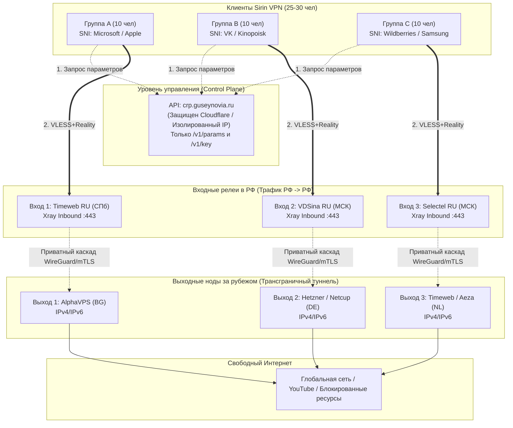

# SPIKE: Архитектура защиты «Невидимая вуаль» для Sirin VPN (2026)

> **Статус документа:** Research / Spike  
> **Целевая аудитория:** 25–30 активных клиентов (клиентская база в РФ)  
> **Оператор противодействия:** ТСПУ / РКН (профиль угроз 2026 года)  
> **Текущий релизный шлюз:** 94.183.159.114 (`sirin-main`), API `crp.guseynovia.ru`

---

## 1. Модель угроз ТСПУ и РКН (2026)

В 2026 году блокировки в РФ перешли от примитивной фильтрации по черным спискам IP/доменов к многоуровневому аппаратному анализу (ТСПУ на базе EcoFilter/RDP.RU) с поддержкой машинного обучения и поведенческой эвристики. Дополнительно с января 2026 года российским облачным операторам ужесточен регламент предоставления «белых» IP под транзитные туннели.

| Вектор угрозы | Механизм работы в ТСПУ (2026) | Риск для группы 25–30 клиентов на одном VPS |
| :--- | :--- | :--- |
| **Корреляция трафика и NetFlow (AI/ML)** | ИИ-модели анализируют энтропию, длительность TCP/UDP-сессий, соотношение входящих/исходящих пакетов и их размеры (packet length histogram). | **КРИТИЧЕСКИЙ.** 25–30 одновременных пользователей генерируют 50–200 Мбит/с непрерывного трафика с десятков домашних провайдеров РФ (Ростелеком, МТС, Дом.ру) на **один** зарубежный IP. Такой профиль выделяется среди бытового веб-серфинга за секунды. |
| **Блокировка по ASN и подсетям хостингов** | РКН превентивно блокирует диапазоны /24 и /20 зарубежных дата-центров (Hetzner, OVH, DigitalOcean, а также подсети CGI Global/CloudBackbone/Hostkey). | **ВЫСОКИЙ.** При попадании соседнего адреса из подсети `94.183.159.0/24` в реестр, подсеть банится целиком на магистральных ТСПУ, отрезая всех 30 клиентов разом. |
| **Запрет облачных «белых» IP (закон 2026 г.)** | Запрет на нецелевое использование и перепродажу «чистых» публичных IP-адресов под анонимайзеры у хостинг-провайдеров в юрисдикции РФ. | **СРЕДНИЙ.** Входные серверы в РФ должны мимикрировать под легитимные сервисы (личный веб-сайт, edge-кэш, API-сервис) с валидным reverse DNS и HTTP-заглушкой. |
| **Блокировка протоколов по сигнатурам (UDP / WireGuard)** | ТСПУ дропает UDP-трафик с нестандартными заголовками или блокирует UDP по портам во время учений и принудительных ограничений. | **ВЫСОКИЙ.** UDP Noise NK (порт 56005) может работать на проводном интернете, но глушится на мобильных операторах (Билайн, Мегафон, МТС, Теле2). |
| **Active Probing (Активное сканирование)** | При обнаружении подозрительного TLS-соединения ТСПУ отправляет зондирующие запросы (Replay attack, проверка сертификата, HTTP fallback). | **СРЕДНИЙ.** VLESS+Reality успешно отбивает Active Probing, возвращая валидный TLS-сертификат маскируемого сайта (fallback dest). Однако при несовпадении SNI и IP-репутации возможен бан. |
| **SNI-фильтрация и ASN-несоответствие** | ТСПУ сопоставляет домен в ClientHello SNI с автономной системой целевого IP. Если SNI `sun8-21.userapi.com` (AS VK), а IP принадлежит иностранному хостеру (AS56971 NL), эвристика фиксирует аномалию. | **ВЫСОКИЙ.** Зарубежный IP с российским SNI привлекает внимание систем глубокого анализа при длительных непрерывных сессиях. |
| **DNS-спуфинг и блокировка API** | Если домен API управления (`crp.guseynovia.ru`) заблокирован или резолвит на заблокированный IP, клиенты не могут обновить параметры шлюзов. | **КРИТИЧЕСКИЙ.** Сейчас API и VPN находятся на одном IP-адресе. Бан IP выводит из строя и туннель, и канал доставки новых конфигураций. |

---

## 2. Аудит текущего покрытия

На основе аудита кодовой базы и инфраструктуры выявлены следующие параметры:

| Компонент / Механизм | Текущее состояние | Оценка защищенности | Что отсутствует |
| :--- | :--- | :--- | :--- |
| **Хостинг** | 1 VPS: Amsterdam, NL (`94.183.159.114`), AS56971 (CloudBackbone / CGI Global). | ⚠️ Single Point of Failure | Нет резервных VPS, нет гео-диверсификации, хостинг в единой зарубежной AS. |
| **Транспорты** | Первичный: UDP Noise NK (`56005`).<br>Резервный: VLESS+Reality (`443`). | 🟡 Удовлетворительно | Нет XHTTP (HTTP/2 / HTTP/3 stream), нет WebSocket/gRPC резерва при жестком шейпинге TLS. |
| **SNI маскировка** | 4 домена: `sun8-21.userapi.com`, `www.kinopoisk.ru`, `wildberries.ru`, `www.ikea.com`. | 🟡 Базовое | Нет доменов глобальных вендоров (Microsoft, Apple, Samsung), нет разделения SNI по группам. |
| **Распределение клиентов** | 25–30 клиентов (12 активных) подключены к одному IP `94.183.159.114`. | 🔴 Критично | Нет релеев, нет балансировки, аномальная концентрация клиентов на одном хосте. |
| **Мониторинг доступности из РФ** | Отсутствует. | 🔴 Слепая зона | Нет синтетических проверок с российских сетей, нет алертинга при блокировке. |
| **Разделение плоскостей (Control / Data Plane)** | API `crp.guseynovia.ru` и VPN-трафик на одном IP `94.183.159.114`. | 🔴 Высокая уязвимость | Блокировка IP VPN мгновенно парализует API выдачи конфигураций. |

---

## 3. Целевая архитектура «Невидимая вуаль» (4 уровня)

Архитектура «Невидимая вуаль» направлена на размывание сетевого следа 25–30 клиентов, исключение прямых трансграничных аномалий и обеспечение непрерывной доступности сервиса.

```
+-----------------------------------------------------------------------------------+
|                           УРОВЕНЬ 3: УСТОЙЧИВОСТЬ                                |
|  - Независимый API (Cloudflare / Edge IP)                                         |
|  - Авто-ротация IP релеев через API хостеров                                      |
|  - Распределенный мониторинг доступности из сетей РФ (Telegram-алерты)             |
+-----------------------------------------------------------------------------------+
                                      ▲
                                      │
+-----------------------------------------------------------------------------------+
|                      УРОВЕНЬ 2: ПОВЕДЕНЧЕСКАЯ МАСКИРОВКА                          |
|  - Пакетный джиттер и динамический паддинг размеров пакетов                       |
|  - Шейпинг пиковой полосы на клиента (burst limit)                                |
|  - Изоляция пулов SNI (для каждой группы клиентов свой набор доменов)             |
+-----------------------------------------------------------------------------------+
                                      ▲
                                      │
+-----------------------------------------------------------------------------------+
|                       УРОВЕНЬ 1: КАСКАД «ВХОД -> ВЫХОД»                           |
|  - Клиенты внутри РФ соединяются ТОЛЬКО с RU-релеями (Timeweb, VDSina, Selectel)   |
|  - Трафик «РФ -> РФ» не вызывает подозрений у трансграничных фильтров ТСПУ        |
|  - Релеи передают трафик на защищенные Exit-ноды в ЕС (AlphaVPS, Hetzner, Timeweb) |
+-----------------------------------------------------------------------------------+
                                      ▲
                                      │
+-----------------------------------------------------------------------------------+
|                            УРОВЕНЬ 0: ТРАНСПОРТ                                   |
|  - VLESS + Reality (XTLS-Vision) с браузерным отпечатком Chrome                   |
|  - XHTTP (HTTP/2-3 стриминг через легитимный CDN)                                 |
|  - Расширенный SNI-пул (VK + Гос/Е-комм + Microsoft + Apple + Samsung)            |
|  - Аварийный резерв: VK TURN / WebRTC                                             |
+-----------------------------------------------------------------------------------+
```

### Уровень 0: Транспортный протокол
- **Reality (XTLS-Vision):** Сохраняется как основной протокол для обхода блокировок TLS-in-TLS.
- **XHTTP (HTTP/2 / HTTP/3 stream) Fallback:** Внедрение транспорта XHTTP для сред, где TCP 443 подвергается жесткому RST-шейпингу со стороны ТСПУ. XHTTP разбивает туннелированный поток на валидные HTTP POST/GET чанки с заголовками браузерного трафика.
- **Расширенный пул SNI:** 8–12 доменов. Добавление доверенных FQDN технологических гигантов, чьи обновления критически важны для функционирования инфраструктуры РФ (`www.microsoft.com`, `dl.delivery.mp.microsoft.com`, `swcdn.apple.com`, `www.samsung.com`), наряду с российскими ресурсами.

### Уровень 1: Каскадирование «Вход (RU) → Выход (EU)» и партиционирование
- Клиенты **никогда не подключаются напрямую к зарубежному IP**.
- 25–30 пользователей делятся на 3 изолированные группы по 8–10 человек.
- Каждая группа подключается к своему входному релею внутри РФ:
  - **Вход 1 (Timeweb Cloud RU, Санкт-Петербург):** обслуживает Группу A (10 клиентов).
  - **Вход 2 (VDSina RU, Москва):** обслуживает Группу B (10 клиентов).
  - **Вход 3 (Selectel RU, Москва):** обслуживает Группу C (10 клиентов).
- Внутри РФ соединение выглядит как обычный локальный HTTPS-трафик пользователя к российскому облаку (AS Timeweb/VDSina/Selectel), что снимает риск трансграничной NetFlow-аномалии.
- Релеи пересылают трафик на зарубежные выходные узлы через приватный туннель (WireGuard/AmneziaWG или зашифрованный mTLS/VLESS каскад):
  - Релей 1 (Timeweb RU) → Exit 1 (AlphaVPS, Болгария / София)
  - Релей 2 (VDSina RU) → Exit 2 (Hetzner / Netcup, Германия)
  - Релей 3 (Selectel RU) → Exit 3 (Timeweb NL / Aeza, Нидерланды)

### Уровень 2: Поведенческая маскировка
- **Traffic Shaping & Jitter:** Искусственное внесение случайных задержек (0–12 мс) и варьирование размеров MTU/padding пакетов на ступенях туннелирования для разрушения характерных гистограмм видеостриминга и VPN-трафика.
- **Групповая изоляция SNI:** Группа A использует пул Microsoft/Apple, Группа B — VK/Яндекс, Группа C — Wildberries/Samsung. Если один SNI попадает под прицельный мониторинг, затрагивается максимум 8–10 человек, а не вся сеть.
- **Ограничение полосы (Fair Use):** Плавное дросселирование аномальных всплесков трафика свыше 50 Мбит/с на одного клиента, предотвращая появление статистических аномалий на интерфейсах релеев.

### Уровень 3: Инфраструктурная устойчивость
- **Разделение Control Plane и Data Plane:**
  - API управления (`crp.guseynovia.ru` или `api.sirin.network`) переносится за Cloudflare Proxy (только HTTP REST / JSON), либо размещается на отдельном изолированном IP-адресе в РФ/ЕС.
  - VPN-шлюзы передаются клиентам исключительно как IP-адреса через `/v1/params`.
  - Даже если все IP релеев будут заблокированы, клиенты сохраняют доступ к API и автоматически стягивают свежие адреса из резервного пула.
- **Авто-ротация IP:** Скрипты интеграции с API хостинг-провайдеров (Timeweb Cloud API / Selectel API) для перевыпуска публичного IP релея по кнопке или при срабатывании алерта мониторинга.
- **Мониторинг из сетей РФ:** Сторонний или автономный синтетический агент в РФ, опрашивающий `/health` всех релеев и выходных нод каждые 3–5 минут с отправкой алертов в Telegram.

---

## 4. Схема потоков данных

### 4.1. Основной каскадный режим (Штатная работа)



### 4.2. Аварийный режим (При тотальной изоляции зарубежных шлюзов)

```
[ Любой клиент ] 
       │ (WebRTC DataChannel / STUN-TURN)
       ▼
[ VK TURN Relay ] (Белый список ТСПУ, легитимный медиа-трафик ВКонтакте)
       │
       ▼
[ Входной релей РФ / Выходной узел ] ───► [ Интернет ]
```

---

## 5. Оценка стоимости инфраструктуры

| Ресурс | Роль | Провайдер / Локация | Ориентировочная стоимость (в мес.) |
| :--- | :--- | :--- | :--- |
| **Входной узел 1** | Релей Группы A | Timeweb Cloud (РФ, 1 vCPU, 1 GB RAM, 100 Мбит/с) | ~200–250 ₽ |
| **Входной узел 2** | Релей Группы B | VDSina (РФ, 1 vCPU, 1 GB RAM) | ~200–250 ₽ |
| **Входной узел 3** | Релей Группы C | Selectel / FirstVDS (РФ, 1 vCPU, 1 GB RAM) | ~250–300 ₽ |
| **Выходной узел 1** | Egress Группы A | AlphaVPS (Болгария, 1 vCPU, 1 GB RAM) | ~€2.5–3.0 (~300 ₽) |
| **Выходной узел 2** | Egress Группы B | Hetzner / Netcup (Германия, 1 vCPU, 1 GB RAM) | ~€3.5–4.5 (~450 ₽) |
| **Выходной узел 3** | Egress Группы C | Текущий VPS NL (`94.183.159.114`) | Уже оплачен (~350 ₽) |
| **API / Control Plane**| Отказоустойчивый API | Cloudflare Free Tier (проксирование DNS и кэш) | 0 ₽ |
| **Домены / DNS** | Основной + Запасной | Reg.ru / Beget (текущий `guseynovia.ru` + 1 fallback домен) | ~300 ₽ / год (~25 ₽/мес) |
| **ИТОГО:** | **Полноценная отказоустойчивая сеть на 30 чел.** | **3 входа + 3 выхода + резерв** | **~1 800 – 2 200 ₽ / месяц** |

*При пересчете на 30 клиентов себестоимость составляет около 65–75 ₽ на человека в месяц.*

---

## 6. Оценка сложности и сроков внедрения

| Этап | Содержание | Трудоемкость | Требуемые изменения в коде |
| :--- | :--- | :--- | :--- |
| **Фаза A** (Быстрый старт) | Мониторинг из РФ, расширение SNI до 8–10 доменов, изоляция API от IP VPN. | 1–2 дня | Минимальные (конфигурации, скрипты, `DefaultSNIPool`). |
| **Фаза B** (Каскадирование) | Развертывание 2–3 RU-релеев, настройка каскадных конфигов Xray, партиционирование клиентов в БД/боте. | 3–5 дней | Модификация `server/internal/api` (выдача `entry` по `client_id` / `relay_id`). |
| **Фаза C** (Клиентские оптимизации) | Поддержка XHTTP fallback в `core/engine`, джиттер пакетов, API ротации IP релеев. | 1–2 недели | Доработки `core/engine` и клиентов (`apps/router`, `apps/desktop`). |
| **Фаза D** (Аварийный контур) | Интеграция VK TURN / WebRTC резерва, CDN-туннели. | 2–3 недели | Реализация Pion WebRTC туннелирования в клиентах. |

---

## 7. Риски и ограничения: что НЕ решает эта архитектура

1. **Белые списки (Полный White-Listing):** Если РКН включит режим фильтрации по жесткому «белому списку» (доступ разрешен только к зарегистрированным сайтам из реестра РКН, остальной трансграничный трафик отсекается), ни один зарубежный выходной узел напрямую работать не сможет. В этом сценарии спасает только Уровень 4 (VK TURN или CDN внутри белого списка).
2. **Компрометация клиентского устройства:** Если на устройстве клиента установлен инспектирующий сертификат или троян/малварь, трафик расшифровывается локально.
3. **Блокировка по пополнению баланса / биллингу:** Санкции и блокировки платежей зарубежных хостеров требуют использования крипто-оплаты или посредников (типа Timeweb Cloud).
4. **Слив конфигурации инсайдером:** Если агент РКН получит ключ из бота и подключится к релею, он сможет идентифицировать IP релея и внести его в бан-лист. Решение: выдача ключей только доверенному кругу лиц (закрытое сообщество до 30 чел).
