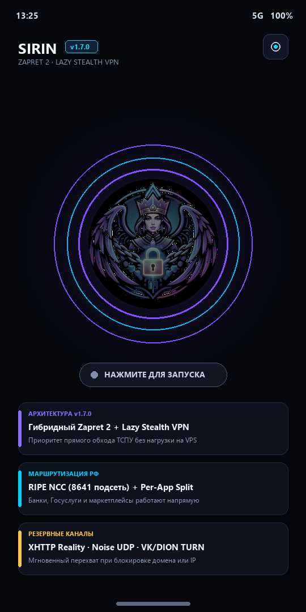
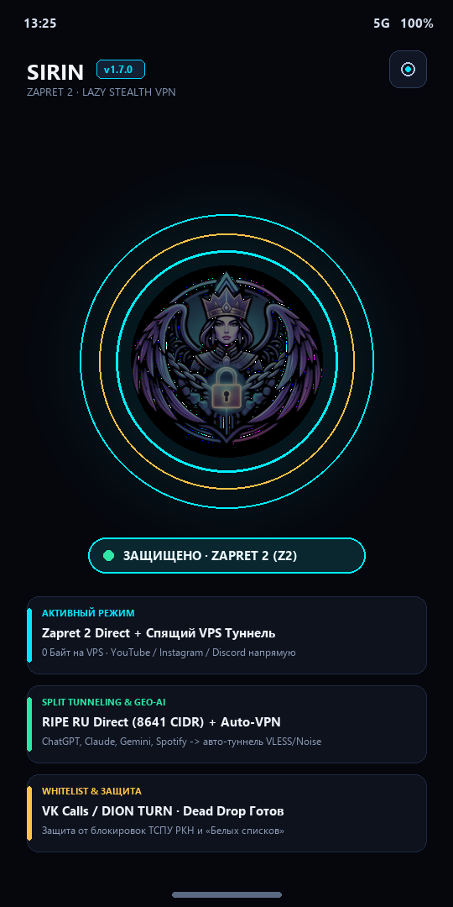
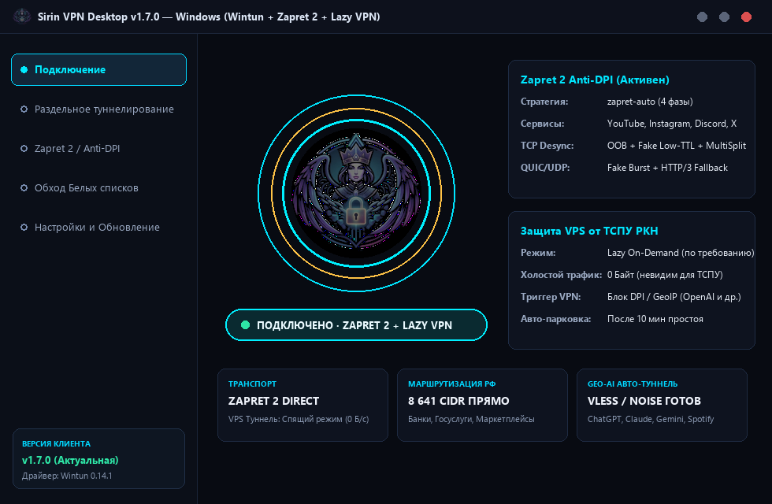
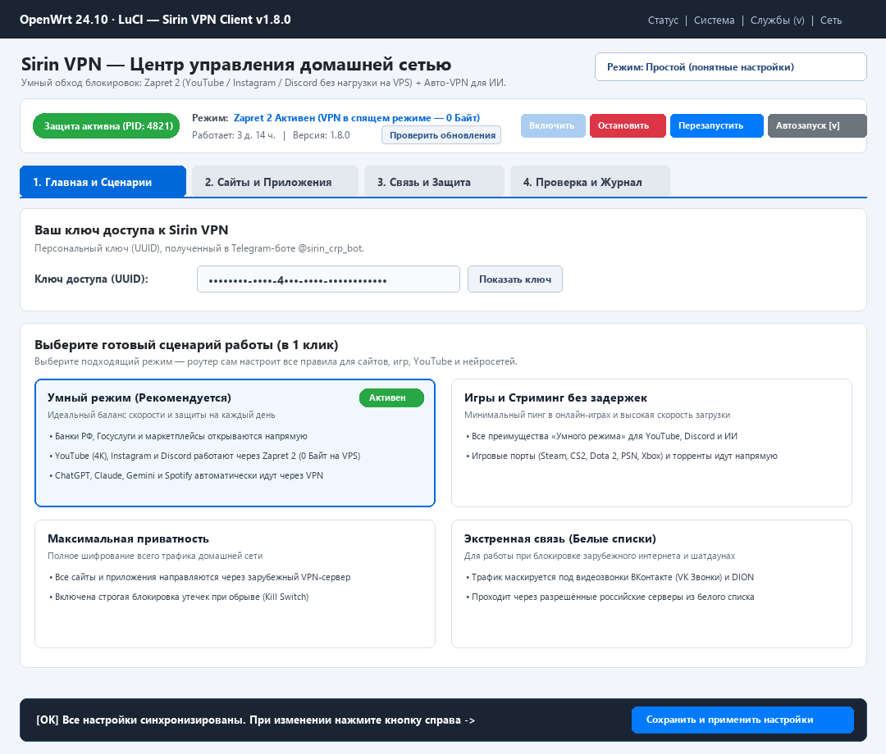

<div align="center">
  
  <h1>Сирин (Sirin) VPN</h1>
  <p><strong>Гибридный комплекс обхода блокировок ТСПУ РКН: нативный Zapret 2 + Спящий (Lazy On-Demand) Stealth VPN для всей экосистемы устройств</strong></p>

  <p>
    <a href="https://github.com/goodbrat-lab/sirin-vpn/blob/master/LICENSE"></a>
    <a href="https://github.com/goodbrat-lab/sirin-vpn/releases/tag/v1.7.0"></a>
    <a href="https://github.com/goodbrat-lab/sirin-vpn/releases/tag/router-v1.8.0"></a>
    <a href="https://github.com/goodbrat-lab/sirin-vpn/releases/tag/desktop-v1.7.0"></a>
    <a href="https://github.com/goodbrat-lab/sirin-vpn/discussions"></a>
  </p>
</div>

---

## ⚡ О проекте (v1.7.0)

**Сирин (Sirin) VPN** — независимый клиент-серверный комплекс обхода интернет-цензуры, объединяющий **прямой обход ТСПУ по технологиям Zapret 2** (адаптивное разбиение TLS Record `SNI`, инъекция `TCP Urgent MSG_OOB`, фейковые пакеты с малым TTL и битой контрольной суммой, `UDP Fake Burst`) и **спящий по требованию (Lazy On-Demand) VPN-туннель** (`VLESS Reality XTLS-Vision`, `XHTTP/2 Reality`, `UDP Noise NK`, а также аварийный канал через `WebRTC TURN ВКонтакте / DION`).

Во время просмотра YouTube, Instagram, Discord и российских сайтов трафик идёт напрямую через провайдера с десинхронизацией DPI (**0 Байт нагрузки на зарубежный VPS**), что защищает сервер от обнаружения и блокировки со стороны ТСПУ РКН. При обращении к гео-заблокированным сервисам (ChatGPT, Claude, Gemini, Spotify, Autodesk) или при жёсткой блокировке IP-адреса ресурса клиент автоматически за миллисекунды пробуждает шифрованный VPN-туннель.

---

## 📱 Выберите платформу

| Платформа | Версия | Где скачать | Руководство | Статус |
|:---|:---:|:---|:---|:---:|
| **Android** | `1.7.0` | [📦 Скачать APK](https://github.com/goodbrat-lab/sirin-vpn/releases/download/v1.7.0/sirin-v1.7.0.apk) | [📖 Инструкция для Android](README.md#11-android) | ✅ Стабильный |
| **Windows Desktop** | `1.7.0` | [📦 Скачать Setup.exe](https://github.com/goodbrat-lab/sirin-vpn/releases/download/desktop-v1.7.0/Sirin-VPN-1.7.0-Setup.exe) | [📖 Инструкция для Windows](README.md#12-windows-desktop) | ✅ Стабильный |
| **Router (OpenWrt)** | `1.8.0` | [📦 Релиз архивы и пакеты (5 архитектур)](https://github.com/goodbrat-lab/sirin-vpn/releases/tag/router-v1.8.0) | [📖 Руководство OpenWrt & LuCI](ROUTER.md) | ✅ Стабильный |
| **iOS / iPadOS** | — | *В разработке (архитектура NetworkExtension)* | [🔬 Исследование (Spike iOS)](SPIKE_IOS.md) | ⏳ Скоро (Q1 2027) |
| **macOS / Linux** | — | *Запланировано на базе Wails & core/engine* | [🗺️ Roadmap](ROADMAP.md) | ⏳ Скоро |

---

## 🚀 Быстрый старт

### 🤖 Android
1. Загрузите и установите [sirin-v1.7.0.apk](https://github.com/goodbrat-lab/sirin-vpn/releases/download/v1.7.0/sirin-v1.7.0.apk).
2. Запустите приложение и вставьте персональный ключ (UUID из Telegram-бота `@sirin_crp_bot` или откройте deep-link ссылку).
3. Нажмите кнопку питания в центре экрана — активируется гибридный режим **Zapret 2 + Lazy VPN (`Z2`)**.

### 💻 Windows Desktop
1. Скачайте инсталлятор [Sirin-VPN-1.7.0-Setup.exe](https://github.com/goodbrat-lab/sirin-vpn/releases/download/desktop-v1.7.0/Sirin-VPN-1.7.0-Setup.exe) и завершите установку.
2. В окне клиента укажите ваш ключ и нажмите **«Подключить»**.
3. Трафик системы защищён; статус отображается в системном трее.

### 🌐 Router (OpenWrt 21.x – 24.x `opkg` и 25.x `apk`)
Выполните одну команду в терминале SSH роутера (автоматически определит архитектуру `mips`, `mipsle`, `armv7`, `arm64`, `x86_64` и установит веб-интерфейс LuCI):
```bash
wget -O - https://raw.githubusercontent.com/goodbrat-lab/sirin-vpn/master/apps/router/install.sh | sh
```
После установки откройте веб-интерфейс роутера: **Службы → Sirin VPN**, введите ключ и сохраните параметры.

---

## 📸 Интерфейс клиентов (v1.7.0)

<div align="center">
  <h3>Мобильное приложение (Android — Cyber-Neon UI)</h3>
  
  &nbsp;&nbsp;&nbsp;&nbsp;
  
</div>

<br/>

<div align="center">
  <h3>Клиент для Windows Desktop</h3>
  
</div>

<br/>

<div align="center">
  <h3>Веб-интерфейс роутера (LuCI OpenWrt)</h3>
  
</div>

---

## 📚 База знаний и документация

- [Индекс всей документации](README.md)
- [Руководство по OpenWrt роутерам и LuCI](ROUTER.md)
- [Сборка и установка пакетов `.ipk` / `.apk`](OPENWRT_PACKAGES.md)
- [Чеклист верификации роутера](ROUTER_INSTALL_VERIFICATION.md)
- [Справочник команд Telegram-бота](BOT_COMMANDS.md)
- [Карта интерфейса бота (UX Map)](BOT_UX_MAP.md)
- [Известные проблемы и решения (Known Issues)](KNOWN_ISSUES.md)
- [Архитектурные решения (Decision Matrix)](DECISION_MATRIX.md)
- [План развития (Roadmap)](ROADMAP.md)
- [Архитектура «Невидимая вуаль»](ROADMAP_INVISIBLE_VEIL.md)

---

## 💬 Сообщество

- [GitHub Discussions](https://github.com/goodbrat-lab/sirin-vpn/discussions)
- [Репозиторий на GitHub](https://github.com/goodbrat-lab/sirin-vpn)
- [Сообщить об ошибке](https://github.com/goodbrat-lab/sirin-vpn/issues/new/choose)
